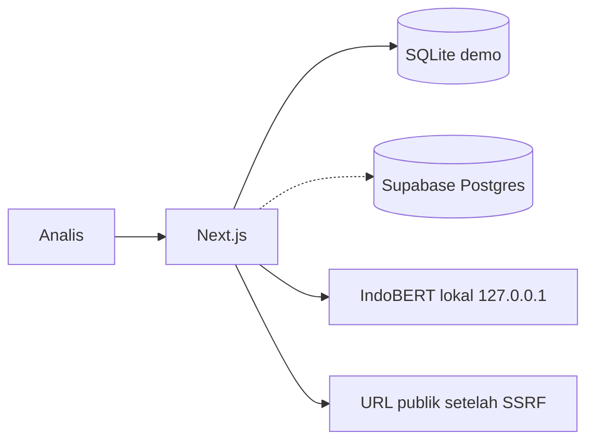
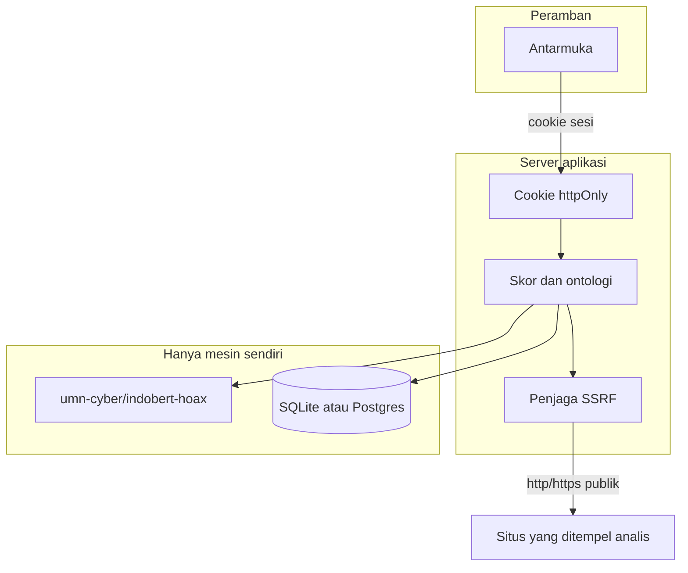

# Kartika Sentinel

Meja peringatan dini dan triase untuk analis siber militer. Aplikasi ini membaca teks atau URL publik, memberi **skor indikasi hoaks**, menandai **topik narasi TNI**, mencocokkan klaim ke **korpus cek fakta**, dan mengurutkan **peringatan demo**. Keputusan tetap di tangan manusia.

Dibuat sebagai purwarupa lintasan Siber Sosial, Kartika Cyber Hackathon 2026 (PUSSIBERAD TNI AD dan CODEPOLITAN).

## Menjalankan

```bash
npm install
npm test
npm run dev
```

Buka [http://127.0.0.1:43123](http://127.0.0.1:43123).

Pada `npm run dev`, halaman masuk menampilkan dua akun latihan (bukan rahasia produksi):

- analis: `analis@kartika.local` / `demo-analis`
- admin: `admin@kartika.local` / `demo-admin`

Di production akun bawaan itu mati. Isi `DEMO_MODE`, sandi, dan `SESSION_SECRET` lewat environment bila mode latihan memang diinginkan. Contoh nama variabel ada di `.env.example`, tanpa nilai rahasia.

### IndoBERT lokal (tanpa token, tanpa Inference API)

Model yang dipakai adalah [umn-cyber/indobert-hoax](https://huggingface.co/umn-cyber/indobert-hoax) (MIT, `BertForSequenceClassification`, label `FAKTA` / `HOAX`). Itu model yang dimuat Space [umn-cyber/indobert-hoax](https://huggingface.co/spaces/umn-cyber/indobert-hoax). Tokenizer **tidak** ada di repo model. Tokenizer diambil dari [indobenchmark/indobert-base-p1](https://huggingface.co/indobenchmark/indobert-base-p1).

```bash
python3 -m pip install -r services/hoax/requirements.txt
# torch CPU: pip install torch --index-url https://download.pytorch.org/whl/cpu
python3 scripts/fetch_indobert.py   # unduhan publik, tanpa token
python3 services/hoax/server.py      # hanya 127.0.0.1:43124
```

Proses model memakai `local_files_only=True`. Permintaan analisis tidak menghubungi Hugging Face. Jika unduhan diblokir atau prosesnya mati, aplikasi lanjut ke model linier di `data/seed/linear-model.json`, lalu ke heuristik leksikal. Demo tidak berhenti.

Bobot safetensors (~475 MB) tidak masuk git. Letaknya `models/`, yang diabaikan git.

Ekspor ONNX dengan Optimum bisa dilakukan di mesin yang sudah punya bobot lokal, bila ingin satu proses Node. Jalur yang jalan di purwarupa ini adalah layanan Python kecil, karena berkas yang dipublikasikan adalah safetensors, bukan ONNX.

## Arsitektur



Batas kepercayaan:



Risiko peringatan:

`hoaks × sensitivitas topik × (0,4 + 0,6 × viralitas)`

Lantai pada viralitas membuat klaim sensitif yang baru muncul tidak tenggelam hanya karena sebarannya masih kecil. Viralitas demo dinormalkan dengan log terhadap langit 20 ribu engagement dan 2 ribu share per jam. Itu skala umpan latihan, bukan konstanta dunia nyata.

Penyematan cek fakta berdimensi **128** (`src/lib/embed/hashing.ts`): hashing kata dan bigram, lalu kosinus. Bukan vektor 768 dari IndoBERT, supaya pencocokan tetap jalan tanpa model neural. Migrasi Postgres memakai `vector(128)` dan indeks HNSW.

## Kriteria penilaian

**Relevansi dan manfaat.** Analis mendapat antrean, bukan umpan mentah. Tiap berkas memuat skor, topik (TNI, Kodam, Papua/KKB, misi luar negeri, UU TNI, alutsista, satuan khusus), padanan cek fakta bersumber, dan bendera media yang hanya bersifat indikasi.

**Inovasi teknis.** Tiga lapis skor berjalan di infrastruktur sendiri: IndoBERT lokal, regresi logistik n-gram, heuristik. Pencocokan cek fakta memakai penyematan hashing. Tidak ada panggilan Inference API dan tidak ada token.

**Fungsionalitas purwarupa.** Dasbor, analisis teks/URL, halaman berkas, ontologi, log audit admin, unduh PDF, dan umpan CSV demo berjalan tanpa Supabase.

**Kelayakan implementasi.** Yang berjalan di purwarupa ini adalah SQLite, jadi demo tidak butuh kredensial. `supabase/migrations/0001_init.sql` menyiapkan skema produksi: RLS tolak-bawaan, peran analis/admin, pemicu audit, `match_fact_checks`, dan `purge_old_data` (unggahan demo lebih dari 90 hari yang tidak terikat kasus). `service_role` tidak pernah memakai awalan `NEXT_PUBLIC_`. Server Next belum menulis ke Postgres secara otomatis.

**Kualitas dokumentasi.** Berkas ini, `.env.example`, dan komentar pada perhitungan yang tidak gamblang.

## Data dan lisensi

| Sumber | Lisensi | Pemakaian di purwarupa |
| --- | --- | --- |
| [umn-cyber/mafindo-2024](https://huggingface.co/datasets/umn-cyber/mafindo-2024) | MIT | Korpus utama. Kartu dataset menyebut 29.552 baris. Berkas `mafindo_cleaned.csv` yang dibaca skrip berisi 14.552 baris. Benih menyimpan 320 baris bertema militer dan 80 baris lain. |
| [umn-cyber/indobert-hoax](https://huggingface.co/umn-cyber/indobert-hoax) | MIT | Model klasifikasi. Dasar fine-tune: indobenchmark/indobert-base-p1. Kartu model melaporkan akurasi evaluasi penulis 0,9831 dan F1 0,9823. Itu bukan hasil uji aplikasi ini. |
| [indobenchmark/indobert-base-p1](https://huggingface.co/indobenchmark/indobert-base-p1) | MIT | Tokenizer saja. |
| [9uz/IDNHoaxCorpus](https://github.com/9uz/IDNHoaxCorpus) | MIT | 40 tweet bertema militer di korpus, plus pelatihan model linier. Berkas CSV yang diunduh berisi 4.617 baris data. |
| [SEACrowd/id_hoax_news](https://huggingface.co/datasets/SEACrowd/id_hoax_news) | CC-BY-4.0 | Tidak dibundel. Lisensi dicatat agar cuplikan tambahan bisa ditarik tanpa mengubah lisensi diam-diam. |
| Cek fakta publik | kutipan singkat | Enam rekam kurasi di `data/seed/curated.json` dengan URL sumber. |

Model linier `linear-ngram-v1` dilatih di mesin ini pada label hoax/valid IDNHoaxCorpus, potongan 80/20, seed 2026. Hold-out 752 contoh: akurasi 0,7407, F1 hoaks 0,8282, presisi 0,8902, recall 0,7743. Angka itu hasil `scripts/train-linear.ts`, bukan klaim kartu IndoBERT.

Dua kalimat percobaan pada IndoBERT lokal (bukan tolok ukur): klaim "20.000 prajurit sudah diterbangkan ke Gaza" mendapat probabilitas HOAX 0,9987; kalimat bernada keterangan Kapuspen tentang latihan udara mendapat 0,9499. Model ini mudah memberi skor tinggi pada teks pendek. Karena itu heuristik tetap ditampilkan terpisah, dan dasbor demo memakai model linier supaya peringkat awal deterministik. Tombol "Skor ulang IndoBERT lokal" memanggil proses di mesin sendiri.

Korpus `nlp-brin-id` tidak dipakai. Repositorinya berpagar dan tidak lagi dipelihara.

Selisih angka misi Gaza tidak digabung paksa. Tempo Cek Fakta, mengutip laman TNI, menulis 88 personel Garuda Merah Putih II. IDN Times menulis 45 kru pada misi airdrop. Kedua kutipan disimpan.

## Etika

- Tidak ada pengikisan akun privat, daftar lawan, atau doxing.
- Umpan dasbor adalah CSV sintetis berlabel demo.
- Pegangan akun di-hash. Nomor telepon, NIK 16 digit, dan pola alamat disamarkan sebelum disimpan dan sebelum ditampilkan.
- URL yang ditempel analis hanya http/https, port 80/443, setelah DNS ditolak bila mengarah ke loopback, privat, link-local, atau metadata.
- Teks pengguna dipotong dan dibersihkan dari karakter kendali. Ia masuk sebagai data klasifikasi, bukan instruksi alat. Tidak ada tool-calling.
- Cookie sesi `httpOnly`. Rute `/api` analis menolak tanpa sesi.

## Variabel lingkungan

Lihat `.env.example`. Untuk Vercel tanpa Supabase, SQLite menulis ke `/tmp` bila disk proyek hanya-baca. Jangan mengawali `SUPABASE_SERVICE_ROLE_KEY` dengan `NEXT_PUBLIC_`. Login Supabase dipakai bila URL dan anon key diisi dan sandi demo tidak cocok; data berkas tetap di SQLite pada purwarupa ini.

Keluar jaringan yang memang ada:

- `127.0.0.1:43124` proses model, tidak dipublikasikan
- host publik yang lolos SSRF, termasuk oEmbed YouTube
- `factchecktools.googleapis.com` hanya bila kunci diisi
- host Supabase hanya bila proyek diisi

Tidak ada `router.huggingface.co` dan tidak ada Inference API.

## Peta jalan

- Modul perilaku terkoordinasi, tetap pada artefak publik dan tanpa daftar akun musuh.
- Dukungan TikTok lewat sumber resmi, bukan pengikisan sesi pribadi.
- Deteksi deepfake yang lebih kuat, tetap berlabel indikasi, idealnya model ONNX di mesin sendiri.
- Nonce CSP yang lebih ketat daripada kebijakan dasar yang sekarang.
