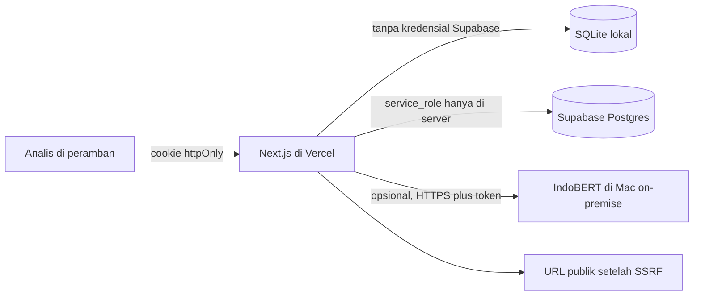
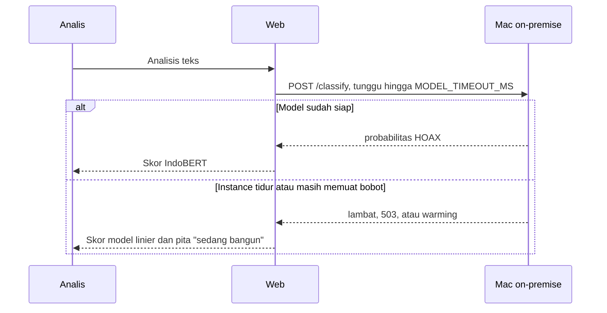

# Arsitektur Kartika Sentinel

Dokumen ini untuk menjelaskan sistem di depan juri. Tidak ada angka kinerja yang diukur di sini selain yang sudah dicatat di README.

## Gambar alur

Cold start:

## Dua proses

Web dan model sengaja dipisah.

- Web adalah Next.js. Di laptop ia memakai SQLite. Di Vercel ia memakai Supabase bila `SUPABASE_URL` dan `SUPABASE_SERVICE_ROLE_KEY` terisi. Kunci `service_role` tidak pernah diberi awalan `NEXT_PUBLIC_`.
- Model adalah proses Python `services/hoax/server.py`. Ia memuat `umn-cyber/indobert-hoax` dengan tokenizer `indobenchmark/indobert-base-p1`. Tidak ada Inference API. Image Docker mengunduh bobot saat build dan memasang wheel torch CPU.

Jalur utama web tidak membutuhkan mesin model. `LOCAL_HOAX_URL` kosong membuat status `ringan`: n-gram dan heuristik di proses Next.js. IndoBERT hanya dipanggil bila URL itu diisi, biasanya tunnel dari Mac (`docs/ONPREM.md`). Cloud Run tetap terdokumentasi sebagai opsi, bukan syarat.

## Skor

Urutan mesin ada di `src/lib/model/classify.ts`:

1. IndoBERT lokal, bila jawaban tiba sebelum waktu habis.
2. Regresi logistik n-gram di `data/seed/linear-model.json`.
3. Heuristik kata.

Skor utama tidak dicampur. Heuristik tetap disimpan agar analis melihat alasan leksikal.

Risiko peringatan dihitung di `src/lib/scoring/risk.ts`:

`hoaks × sensitivitas topik × (0,4 + 0,6 × viralitas)`

Penyematan cek fakta berdimensi 128 di `src/lib/embed/hashing.ts`. Itu hashing kata, bukan vektor 768 IndoBERT. Migrasi Postgres memakai `vector(128)`.

## Data

`src/lib/db/index.ts` memilih backend. `DATA_BACKEND=sqlite` memaksa SQLite. Tanpa kunci Supabase, SQLite juga yang dipakai. RLS di `supabase/migrations/0001_init.sql` menolak akses anon. Server menulis lewat service role setelah sesi analis diperiksa di aplikasi.

## Yang tidak dilakukan sistem

Sistem tidak mengikis akun, tidak membuat daftar lawan, dan tidak menetapkan hoaks. Bendera AI adalah stilometri plus metadata gambar, dijelaskan di `src/lib/model/ai-text.ts` dan `src/lib/media/metadata.ts`.
